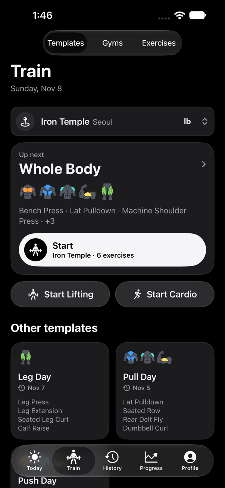
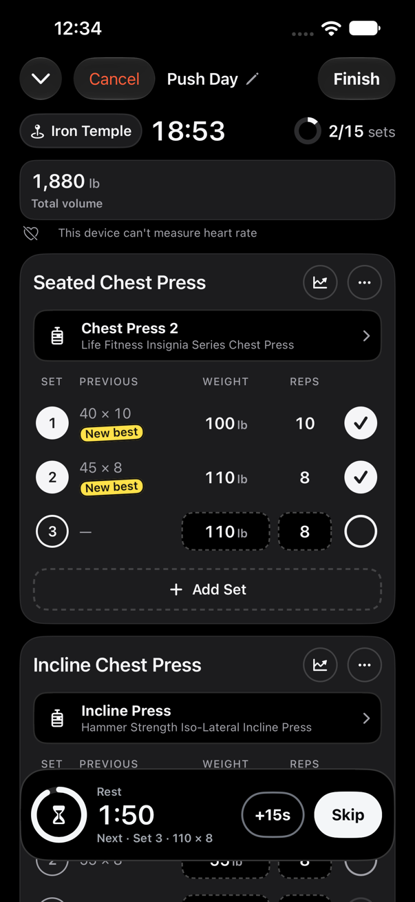
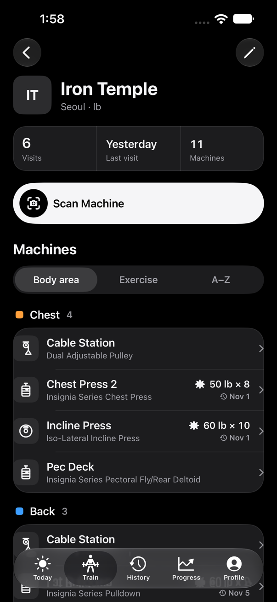
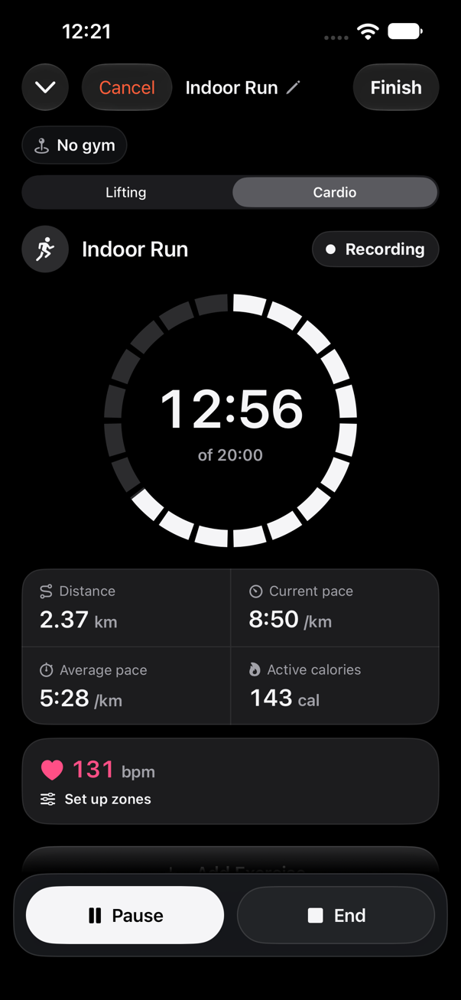
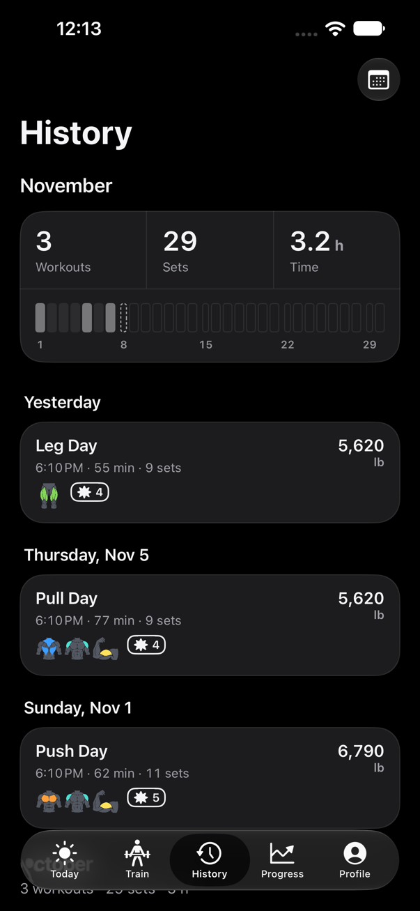
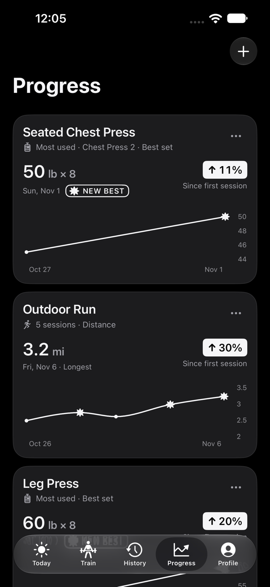
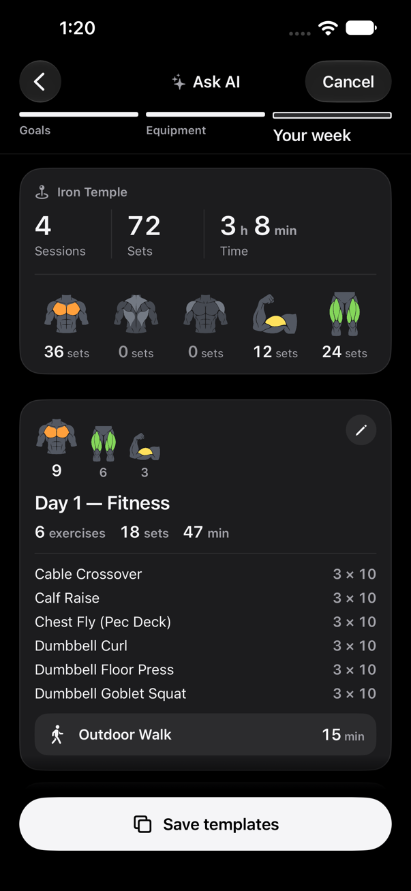
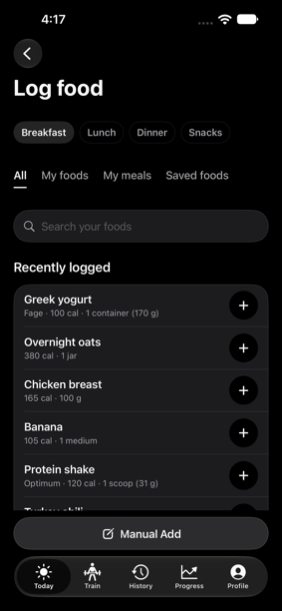

# Stacked

**Know your numbers. Every machine. Every gym.**

Stacked is an iPhone workout logger that knows which machine you're on. It is in a **TestFlight beta**
for invited testers; an App Store release is planned after it. (The repository and Xcode project keep the
working name, Workout Tracker.)

I move around a lot, and every gym has different equipment. In other trackers I had to log
everything under a generic "chest press" or "shoulder press", so a 60 kg set on one gym's
plate-loaded press and a 60 kg set on another's cable machine looked identical in my history
and nothing was comparable. Stacked anchors machine sets to a specific machine at a specific
gym (free weights and bodyweight work are logged too). Previous performance and records are per
machine first, per equipment model second, and per exercise only as a last resort — each layer
labelled so you know what you're comparing against. Sets are prefilled only from that same
machine.

<!-- Screenshots in docs/readme/: the capture UI tests' Soft look (dark, default text size, built-in sample data),
taken 2026-11-08 and resized to 603 px wide. Retake them when a shown screen changes visibly (AGENTS.md). -->
<p>








</p>

## What it does

- **Five tabs.** Today (this week, the day's food against your goal, today's template — learned from the order you train
  in, or your own split — and today's log), Train (templates, gyms and exercises, Start Lifting / Start Cardio), History, Progress and Profile (your
  account card, settings grouped into short pages, and help).
- **Gyms and machines.** Each gym has its own machines. Adding one can read its name plate on
  the phone and match it against a seeded catalog of 1,877 equipment models from 23
  manufacturers.
- **Fast logging.** Set rows arrive prefilled from your last session on that machine;
  confirming an untouched row is one tap. Add Exercise picks by name or by the gym's machines (a
  machine fills in its exercise). Weights keep the unit you entered, kg or lb, and
  are never silently converted. Supersets, presets (grips, stances), and the workout with its
  rest timer on the Lock Screen.
- **Cardio.** Indoor machines and outdoor walks, runs and rides with a GPS route — on their
  own or in the same workout as lifting.
- **Templates.** Save a workout as a plan and start it at any gym (Today suggests the one that comes next; My Split sets
  the order or the weekdays); each exercise resolves to
  the machine you last used or picked for it there (a template's Add Exercise can pick, add or scan a machine).
- **Heart rate and Apple Health.** Live bpm from AirPods Pro 3 or a paired heart-rate monitor,
  zones, calories and a heart-rate rest timer; workouts are saved to Apple Health. (An Apple
  Watch companion is written but not yet built or shipped.)
- **History.** A journal by day (Today, Yesterday, then each date) under a month summary, a calendar, per-session detail with editing (down to removing one set, exercise or
  cardio activity), records, progress charts per exercise and variation, and export of your
  workouts as JSON (the fullest record, with heart-rate series and routes) or CSV (a table of
  sets and cardio). *Unreleased, on `main`:* the JSON (format v12) also carries the nutrition data — food log, saved
  foods, My meals, nutrition goals, body weights and Personal details; the CSV stays sets and cardio.
- **Progress.** A tab of the charts you pin — lifts per machine or weight (best set, volume,
  1RM) and cardio activities (distance, pace or speed, time) — each with its latest value and
  the change since your first session — plus training-wide weekly charts (workouts, training volume, running
  distance). Tap one for the full chart, its bests and sessions; its "…" or a long-press moves or removes it.
  Add Chart lists the exercises you've logged by body area.
- **Optional account and AI.** Sign in with Apple or Google to identify a machine from a
  photo, get exercise suggestions for a new machine, or have Ask AI build a week of
  templates from your training profile. Each training AI feature asks first; every AI feature has a daily limit.
- **Food logging** *(on `main`, not yet in TestFlight)*. On Today each day's ring fills toward that day's calorie goal
  in protein · carbs · fat colours; the fuel card shows what's left (or over), what you ate and burned — burned never
  changes the goal — and protein to go; without goals it offers to set them. Today's log lists the food by meal; tap an
  entry to change its servings, meal or numbers, or delete it with Undo.
  **Log food** opens the meal (preset by the time of day), tabs **All / My foods / My meals / Saved foods** and a
  search over your own foods. Each food or meal has a **+** that logs one serving at once, with Undo; tapping a food
  picks the servings. **Manual Add** logs a one-off entry (a name is optional, so calories alone are enough);
  **Add food** creates one of My foods in two steps (brand, description, serving, servings per container → nutrition);
  the bookmark keeps any food in Saved foods; **Create meal** groups foods you eat together. Each entry keeps its own
  copy of the numbers, so editing or deleting a food or meal never changes a day already logged.
  **Scan food** (signed in; the camera beside Log food, or in Log food's bar) has three modes. *Scan food*: the camera
  closes at once and Today's log shows the photo with a progress ring; the estimate is logged as one entry named for
  the meal, its photo kept on the iPhone with it (a photo chosen from the library is logged when it was taken). Tap it
  to edit the name, meal or any item, or delete it with Undo. *Food label*: the label inside the box is read and opens
  as a food to name and log, saved to My foods if you like. *Barcode* comes next. Typing in Log food's search also
  offers **Estimate "…"**, logged the same way. Meal photos stay out of the JSON export (it carries their items).
- **Body weight** *(on `main`, not yet in TestFlight)*. Profile → Body weight shows your
  latest weight and its history; Log weight takes the figure with ± steps in your unit (kg or lb, kept as entered) and
  the time; tap an entry to change or delete it. When your weight is more than about 2 kg from the one your nutrition
  goals were calculated at, it offers to recalculate them.
- **Apple Health for food and weight** *(on `main`, not yet in TestFlight)*. Profile → Apple Health has a switch for
  each part, each asking Health's permission when first turned on: read your body weight (shown in Body weight's
  history as "Apple Health", read-only), read the day's active energy (shown as Burned on Today, never added to the
  budget), save the weights you log, and save each food entry's calories, protein, carbs and fat. Edits and deletes
  follow to Health; turning a switch off stops new changes and leaves what is already in Health.
- **Nutrition goals** *(on `main`, not yet in TestFlight)*. Profile → Personal details
  holds your weight, height, date of birth and sex — one place, also used by the heart-rate zones and Ask AI. From
  them Profile → Nutrition goals calculates daily calories, protein, carbs and fat (Mifflin–St Jeor, your activity and
  goal); type over any number, and a change dates a new goal so past days keep theirs. A new install is offered the
  goals once after the welcome page.
- **A safety copy before data changes** *(on `main`, not yet in TestFlight)*. Before an update first opens your data
  in a new stored format, the app copies it on the phone (the newest two copies are kept, inside the iPhone's own
  backup); Profile → Export & backup → Safety copy restores one, at the next launch.
- **Onboarding and feedback.** A guided tour of the real app on sample data, a one-time
  What's New page after a big update (and in Profile), and Profile → Send Feedback with an
  optional screenshot.

## Privacy

Your workouts are stored on your iPhone and are never uploaded automatically. What you choose
to send — sign-in, AI requests, feedback (and anything you put in it) — goes through a small
server of mine. The
[privacy policy](https://stacked-server.stacked-server.workers.dev/privacy) says exactly what is
kept and for how long; [support](https://stacked-server.stacked-server.workers.dev/support).

## Building

Requires iOS 26. Builds and tests are verified with Xcode 27; Xcode 26 currently fails to
compile one file on the hosted CI runner (an open issue in [`docs/STATE.md`](docs/STATE.md)).
The simulator build needs no signing:

```sh
xcodebuild -project WorkoutTracker.xcodeproj -scheme WorkoutTracker \
  -sdk iphonesimulator -configuration Debug build
```

For a real phone, copy `Config/Local.xcconfig.example` to `Config/Local.xcconfig` with your own
team ID and bundle-ID prefix, then run `./scripts/install-on-device.sh`. Unit tests, on any
available iPhone simulator (`xcrun simctl list devices available`; use its ID if the name exists
under more than one iOS version):

```sh
xcodebuild test -project WorkoutTracker.xcodeproj -scheme WorkoutTracker \
  -sdk iphonesimulator -destination 'platform=iOS Simulator,id=<simulator ID>' \
  -testPlan Unit
```

Tests are grouped into Xcode test plans in `TestPlans/`: `Unit`, one per app area for the UI tests (`TodayTrain`,
`Workout`, `HistoryProgress`, `GymsExercises`, `ProfileAI`, `Review`) and `Full` (everything, the default).
`scripts/prepare-test-simulator.sh <simulator ID>` keeps the simulator booted between runs, and
`scripts/explore.sh` launches the app with sample data and saves screenshots without writing a test.

The server is a Cloudflare Worker (TypeScript, D1, R2): `cd server && npm install && npm test`.
Setup, secrets and deployment are in [`server/README.md`](server/README.md); secrets are never
in this repository.

## Layout

| Folder | What it holds |
|---|---|
| `WorkoutTracker/` | The app: `App/`, `Domain/` (SwiftData models and pure logic), `Features/` (one folder per area: today, train, workout, cardio, gyms, exercises, templates, history, progress, settings, account, onboarding), `Resources/` (the seeded catalog) |
| `WorkoutTrackerTests/`, `WorkoutTrackerUITests/` | Unit tests (Swift Testing) and end-to-end UI tests (XCTest) |
| `WorkoutTrackerWidget/` | The Live Activity: the running workout and its rest timer on the Lock Screen |
| `WorkoutTrackerWatch/` | An Apple Watch companion (workout session, heart rate, phone link) — written, never built or run, not in the beta |
| `server/` | The backend: accounts (Apple, Google), the AI proxy with daily limits, feedback, the privacy and support pages |
| `TestPlans/` | The named test groups (Xcode test plans), written by `scripts/test-plans.py` |
| `Config/`, `scripts/` | Build settings (`Local.xcconfig` is yours and git-ignored), catalog generation, device install, the secret scanner, test helpers |
| `AGENTS.md`, `CLAUDE.md`, `CONTEXT.md` | Shared agent workflow, Claude's import of it, the domain glossary |
| `docs/` | `SPEC.md` (product), `DECISIONS.md` (why), `STATE.md` (current work), `DEVELOPMENT.md` (runbook), `archive/` (preserved handoffs) |
| `work-record/` | Every ticket with its acceptance criteria and resolution, every cross-review, and the screenshots each ticket was judged on |

## How it was built

Solo, with AI coding agents under a workflow described in [`AGENTS.md`](AGENTS.md): work is
split into numbered tickets; each ticket is built by one agent and cross-reviewed by a
different one (Claude and Codex) until it is clear; screens go through a written design
process with captures at the default and accessibility text sizes; and tests are chosen by
what a change can affect ([verification scope](docs/DEVELOPMENT.md#verification-scope)), with the
full UI suite for broad changes. The decision log and the work record are the paper trail.

**Status:** TestFlight beta for invited testers (October 2026); App Store release later. The
current work is in [`docs/STATE.md`](docs/STATE.md).
