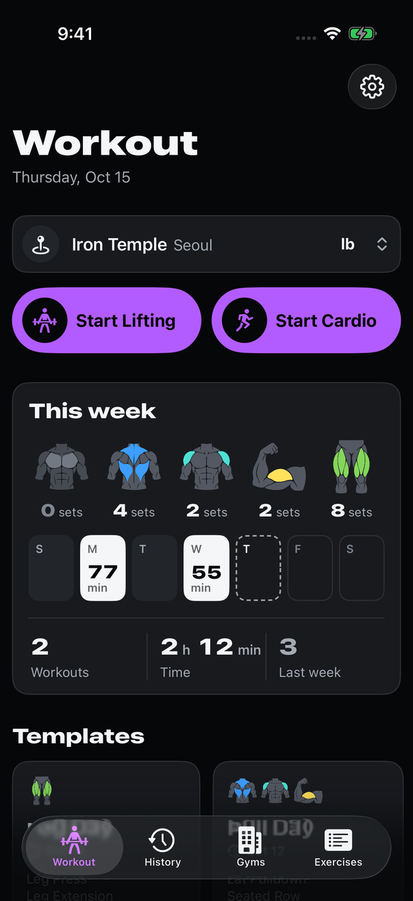
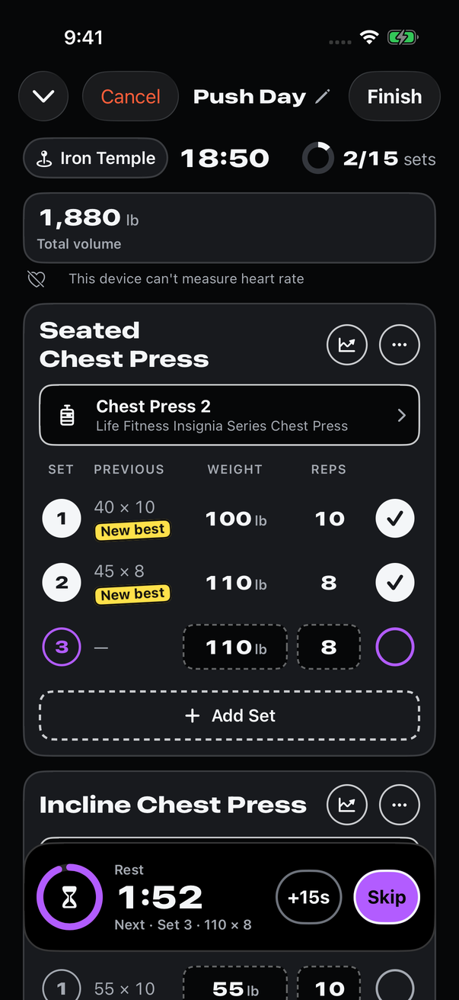
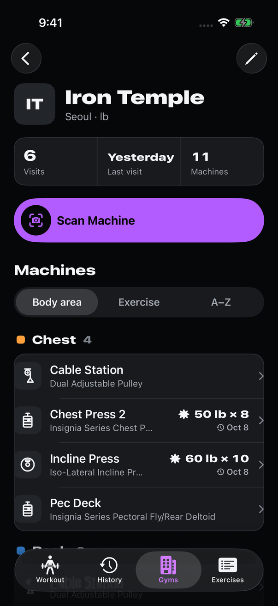
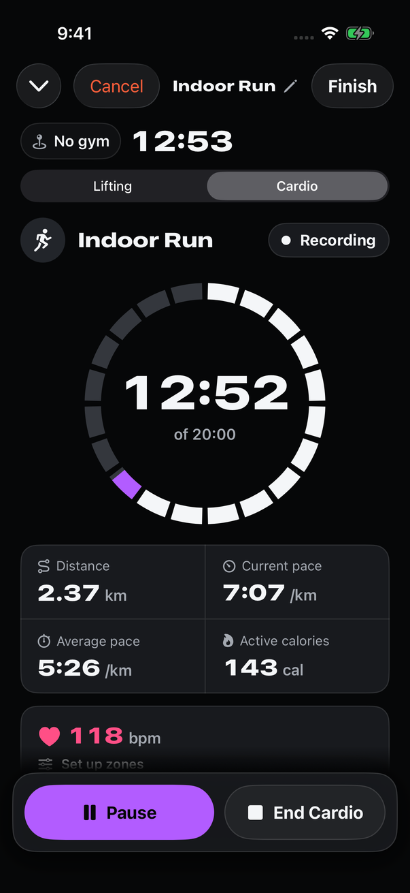
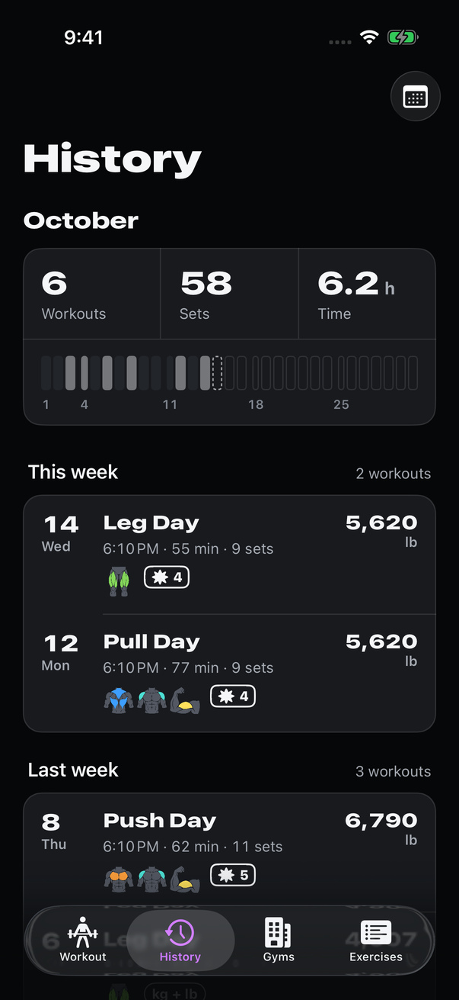
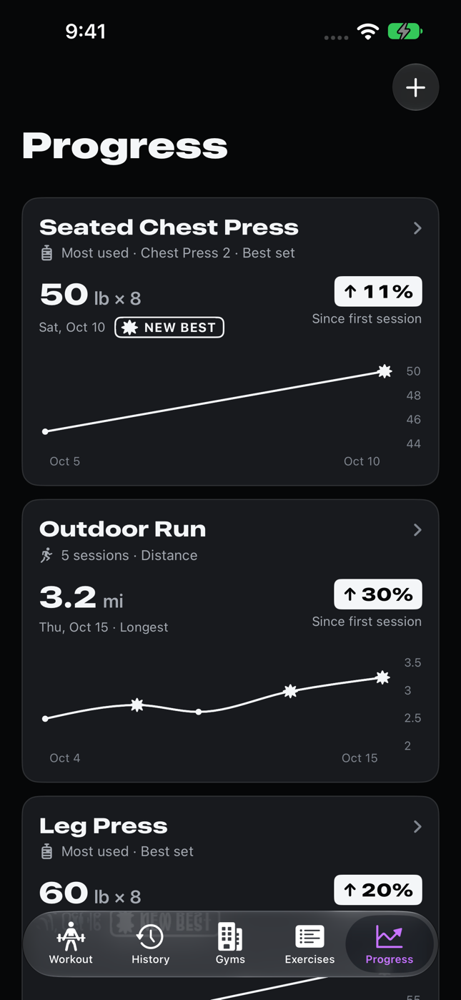
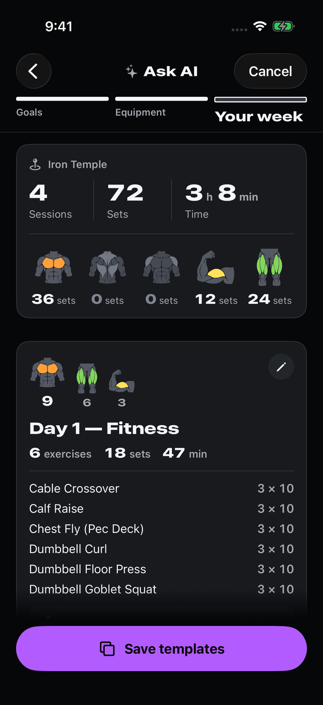

# Stacked

**Know your numbers. Every machine. Every gym.**

Stacked is an iPhone workout logger that knows which machine you're on. It is in a **TestFlight beta**
for invited testers; an App Store release is planned after it. (The repository and Xcode project keep the
working name, Workout Tracker.)

I move around a lot, and every gym has different equipment. In other trackers I had to log
everything under a generic "chest press" or "shoulder press", so a 60 kg set on one gym's
plate-loaded press and a 60 kg set on another's cable machine looked identical in my history
and nothing was comparable. Stacked anchors machine sets to a specific machine at a specific
gym (free weights and bodyweight work are logged too). Previous performance and records are per
machine first, per equipment model second, and per exercise only as a last resort — each layer
labelled so you know what you're comparing against. Sets are prefilled only from that same
machine.

<!-- Screenshots in docs/readme/: Floodlight capture UI tests (dark, default text size, built-in sample data),
taken 2026-10-15 and halved in size. Retake them when a shown screen changes visibly (AGENTS.md). -->
<p>







</p>

## What it does

- **Gyms and machines.** Each gym has its own machines. Adding one can read its name plate on
  the phone and match it against a seeded catalog of 1,877 equipment models from 23
  manufacturers.
- **Fast logging.** Set rows arrive prefilled from your last session on that machine;
  confirming an untouched row is one tap. Add Exercise picks by name or by the gym's machines (a
  machine fills in its exercise). Weights keep the unit you entered, kg or lb, and
  are never silently converted. Supersets, presets (grips, stances), and the workout with its
  rest timer on the Lock Screen.
- **Cardio.** Indoor machines and outdoor walks, runs and rides with a GPS route — on their
  own or in the same workout as lifting.
- **Templates.** Save a workout as a plan and start it at any gym; each exercise resolves to
  the machine you last used there.
- **Heart rate and Apple Health.** Live bpm from AirPods Pro 3 or a paired heart-rate monitor,
  zones, calories and a heart-rate rest timer; workouts are saved to Apple Health. (An Apple
  Watch companion is written but not yet built or shipped.)
- **History.** A calendar, per-session detail with editing (down to removing one set, exercise or
  cardio activity), records, progress charts per exercise and variation, and export of your
  workouts as JSON (the fullest record, with heart-rate series and routes) or CSV (a table of
  sets and cardio).
- **Progress.** A tab of the charts you pin — lifts per machine or weight (best set, volume,
  1RM) and cardio activities (distance, pace or speed, time) — each with its latest value and
  the change since your first session; tap one for the full chart, its bests and sessions. Add Chart
  lists the exercises you've logged by body area.
- **Optional account and AI.** Sign in with Apple or Google to identify a machine from a
  photo, get exercise suggestions for a new machine, or have Ask AI build a week of
  templates from your training profile. Each AI feature asks first and has a daily limit.
- **Onboarding and feedback.** A guided tour of the real app on sample data, a one-time
  What's New page after a big update (and in Settings), and Settings → Send Feedback with an
  optional screenshot.

## Privacy

Your workouts are stored on your iPhone and are never uploaded automatically. What you choose
to send — sign-in, AI requests, feedback (and anything you put in it) — goes through a small
server of mine. The
[privacy policy](https://stacked-server.stacked-server.workers.dev/privacy) says exactly what is
kept and for how long; [support](https://stacked-server.stacked-server.workers.dev/support).

## Building

Requires iOS 26. Builds and tests are verified with Xcode 27; Xcode 26 currently fails to
compile one file on the hosted CI runner (an open issue in [`docs/STATE.md`](docs/STATE.md)).
The simulator build needs no signing:

```sh
xcodebuild -project WorkoutTracker.xcodeproj -scheme WorkoutTracker \
  -sdk iphonesimulator -configuration Debug build
```

For a real phone, copy `Config/Local.xcconfig.example` to `Config/Local.xcconfig` with your own
team ID and bundle-ID prefix, then run `./scripts/install-on-device.sh`. Unit tests, on any
available iPhone simulator (`xcrun simctl list devices available`; use its ID if the name exists
under more than one iOS version):

```sh
xcodebuild test -project WorkoutTracker.xcodeproj -scheme WorkoutTracker \
  -sdk iphonesimulator -destination 'platform=iOS Simulator,id=<simulator ID>' \
  -only-testing:WorkoutTrackerTests
```

The server is a Cloudflare Worker (TypeScript, D1, R2): `cd server && npm install && npm test`.
Setup, secrets and deployment are in [`server/README.md`](server/README.md); secrets are never
in this repository.

## Layout

| Folder | What it holds |
|---|---|
| `WorkoutTracker/` | The app: `App/`, `Domain/` (SwiftData models and pure logic), `Features/` (one folder per area: workout, cardio, gyms, exercises, templates, history, progress, settings, account, onboarding), `Resources/` (the seeded catalog) |
| `WorkoutTrackerTests/`, `WorkoutTrackerUITests/` | Unit tests (Swift Testing) and end-to-end UI tests (XCTest) |
| `WorkoutTrackerWidget/` | The Live Activity: the running workout and its rest timer on the Lock Screen |
| `WorkoutTrackerWatch/` | An Apple Watch companion (workout session, heart rate, phone link) — written, never built or run, not in the beta |
| `server/` | The backend: accounts (Apple, Google), the AI proxy with daily limits, feedback, the privacy and support pages |
| `Config/`, `scripts/` | Build settings (`Local.xcconfig` is yours and git-ignored), catalog generation, device install, the secret scanner |
| `AGENTS.md`, `CLAUDE.md`, `CONTEXT.md` | Shared agent workflow, Claude's import of it, the domain glossary |
| `docs/` | `SPEC.md` (product), `DECISIONS.md` (why), `STATE.md` (current work), `DEVELOPMENT.md` (runbook), `archive/` (preserved handoffs) |
| `work-record/` | Every ticket with its acceptance criteria and resolution, every cross-review, and the screenshots each ticket was judged on |

## How it was built

Solo, with AI coding agents under a workflow described in [`AGENTS.md`](AGENTS.md): work is
split into numbered tickets; each ticket is built by one agent and cross-reviewed by a
different one (Claude and Codex) until it is clear; screens go through a written design
process with captures at the default and accessibility text sizes; and tests are chosen by
what a change can affect ([verification scope](docs/DEVELOPMENT.md#verification-scope)), with the
full UI suite for broad changes. The decision log and the work record are the paper trail.

**Status:** TestFlight beta for invited testers (October 2026); App Store release later. The
current work is in [`docs/STATE.md`](docs/STATE.md).
